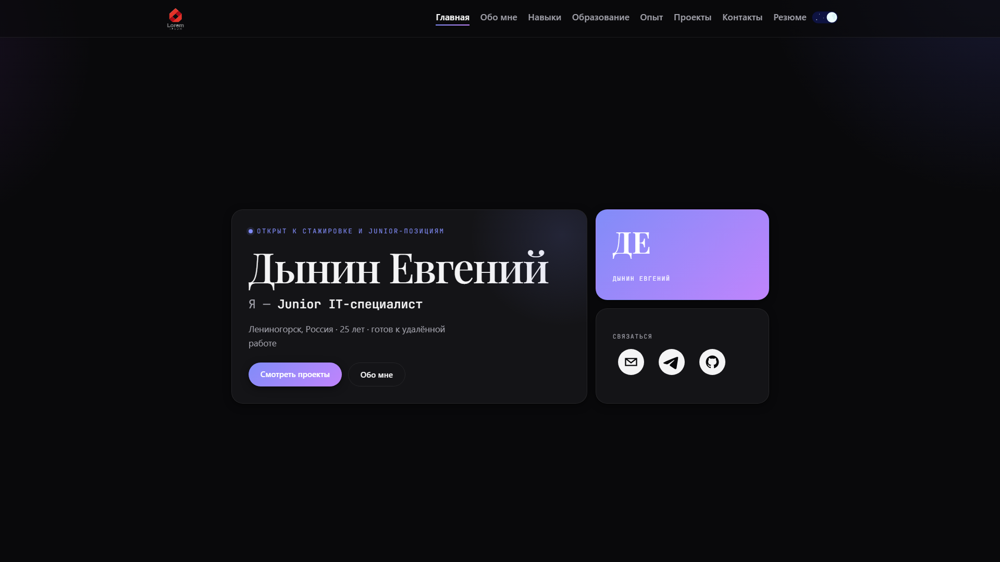

# Портфолио — Евгений Дынин

**Junior IT-специалист: тестирование, анализ кода и защищённости, документация.**

[Сайт](https://jeeas77.github.io/resumeEvgenii/) · [Резюме (HTML)](https://jeeas77.github.io/resumeEvgenii/resume.html) · [PDF](https://jeeas77.github.io/resumeEvgenii/resume.pdf) · [DOCX](https://jeeas77.github.io/resumeEvgenii/resume.docx)



## Что это

Одностраничное портфолио на React с клиентской маршрутизацией: главная, «Обо мне», навыки,
образование, опыт, проекты и контакты. Тёмная и светлая темы, контент вынесен в JSON — код
трогать не нужно, чтобы обновить текст.

Отдельно есть `public/resume.html` — автономная страница резюме: всегда светлая, с кнопкой
печати (сохранение в PDF через диалог браузера) и ссылкой возврата на сайт.

## Стек

- React 18 + Vite 8, `react-router-dom` 6 (`BrowserRouter`, `basename="/resumeEvgenii"`)
- Bootstrap 5 через `react-bootstrap`, стили — `styled-components` и обычный CSS с дизайн-токенами
- `react-markdown` для текстов, `react-awesome-reveal` для анимаций, `react-social-icons` для иконок
- Тесты — Vitest + Testing Library, линт — ESLint (airbnb)

## Быстрый старт

Нужен Node.js 20.19+ или 22.12+ (требование Vite 8).

```bash
npm install

npm run dev      # http://localhost:3000/resumeEvgenii/ — адрес важен, см. «base» ниже
npm run build    # сборка в build/
npm run preview  # локальный просмотр собранной версии
npm test         # Vitest
npm run lint     # ESLint по src/
npm run deploy   # публикация на GitHub Pages
```

## Структура

```
public/profile/*.json   весь контент сайта (тексты, ссылки, пути к картинкам)
public/images/          логотип, фото, иконки навыков и постеры проектов
public/resume.html      страница резюме для печати
public/resume.pdf       готовые файлы резюме для ссылок
src/components/         компоненты страниц и общие блоки
src/constants/          endpoints.js — адреса JSON через import.meta.env.BASE_URL
src/css/, src/theme/    стили и палитры светлой/тёмной темы
vite.config.js          base: '/resumeEvgenii/', outDir: 'build'
```

## Где править контент

| Файл | Что внутри |
| --- | --- |
| `home.json` | имя, роли для печатающегося текста, статус, подпись |
| `navbar.json` | логотип и пункты меню; `"type": "link"` открывает пункт в новой вкладке |
| `routes.json` | список страниц, их пути и заголовки |
| `about.json` | текст «Обо мне» (markdown) и фото |
| `skills.json` | категории навыков и иконки |
| `education.json`, `experiences.json` | записи таймлайна |
| `projects.json` | карточки проектов: описание (markdown), ссылки, теги |
| `contacts.json` | контакты и ссылки на файлы резюме |
| `social.json` | иконки соцсетей на главной; `email` копирует адрес в буфер обмена |

Пути к картинкам в JSON указываются относительно корня сайта (`images/skills/git.png`) —
абсолютный адрес собирается в `src/utils/resolvePath.js`.

JSON-файлы сохранены в UTF-8: редактируй их в редакторе, который не пересохраняет файл в ANSI,
иначе кириллица превратится в мусор.

## Страница резюме

`public/resume.html` — обычный статический HTML без сборки и зависимостей. Печатается на A4,
тема принудительно светлая, панель с кнопками при печати скрывается. Чтобы обновить резюме,
правь этот файл; `resume.pdf` и `resume.docx` в `public/` обновляются отдельно.

## Деплой на GitHub Pages

```bash
npm run deploy
```

Что происходит: `predeploy` собирает проект и копирует `build/index.html` в `build/404.html`
(иначе прямые ссылки на разделы отдают 404 без контента), затем `gh-pages` публикует папку
`build/` в ветку `gh-pages`, откуда её раздаёт GitHub Pages.

Данные профиля запрашиваются с `cache: 'no-store'`, поэтому после деплоя правки в JSON видны
сразу, без ожидания кэша браузера. Сами HTML/JS файлы кэшируются как обычно — после публикации
может понадобиться обновить страницу с Ctrl+F5.

### `base` и абсолютные адреса

Сайт живёт в подкаталоге `/resumeEvgenii/`, поэтому путь зашит в нескольких местах. Если
переименовать репозиторий, обнови все:

1. `base` в `vite.config.js`
2. `basename` в `src/App.jsx`
3. абсолютные ссылки в `public/profile/navbar.json` и `public/profile/contacts.json`

## Лицензия и благодарности

Проект вырос из шаблона [dev-portfolio](https://github.com/mayankagarwal09/dev-portfolio)
(автор — Mayank Agarwal), распространяется по лицензии MIT: см. [LICENSE.md](LICENSE.md).
Текст лицензии и копирайт автора шаблона сохраняются.
